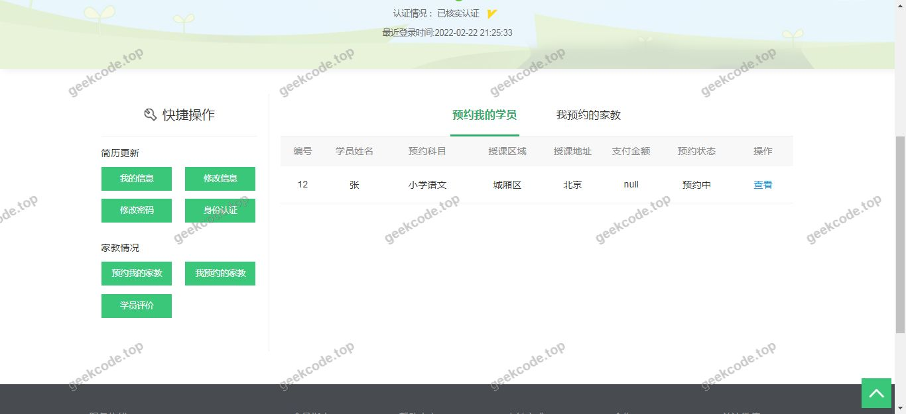
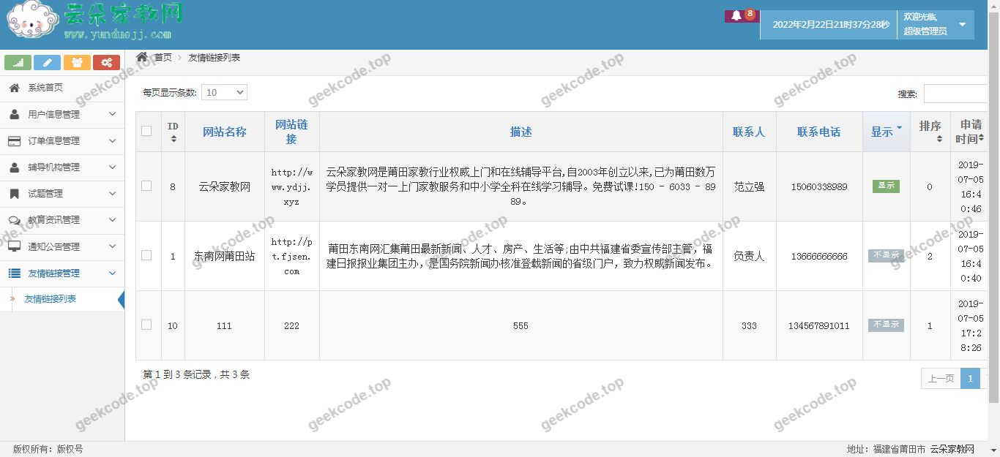
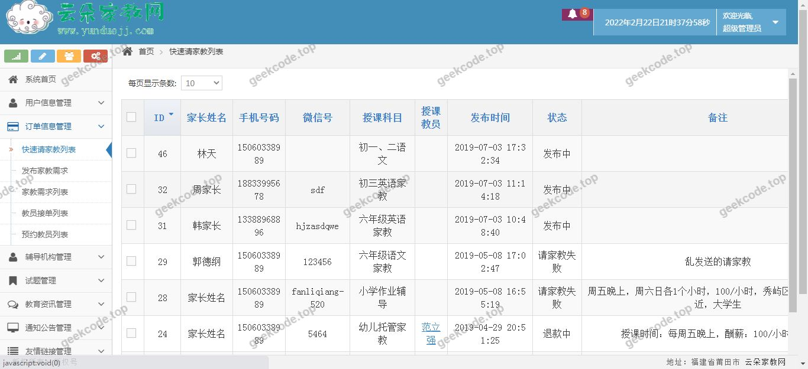
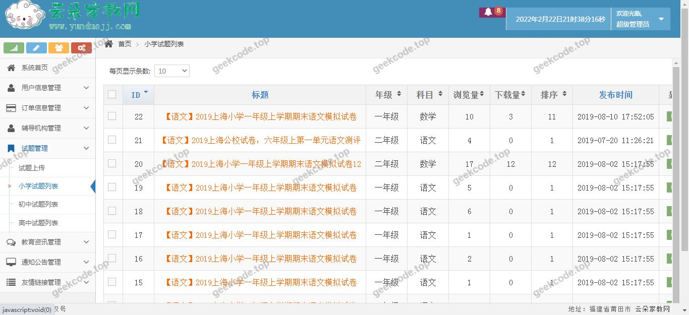

# java精品项目-基于ssh的上门家教在线预约系统-带

> 🎓 **计算机毕业设计 · java精品项目-基于ssh的上门家教在线预约系统-带**
>
> 本仓库只放**项目介绍 + 运行截图**（截图是站点带水印的原图，存在仓库 `images/` 里）。
>
> 👉 **完整可运行源码 / 数据库脚本 / 部署文档：[点我获取](https://geekcode.top/archives/java%E7%B2%BE%E5%93%81%E9%A1%B9%E7%9B%AE-%E5%9F%BA%E4%BA%8Essh%E7%9A%84%E4%B8%8A%E9%97%A8%E5%AE%B6%E6%95%99%E5%9C%A8%E7%BA%BF%E9%A2%84%E7%BA%A6%E7%B3%BB%E7%BB%9F-%E5%B8%A6?utm_source=github)**
>
> 💬 咨询微信：**ir9372**　|　🌐 更多项目：[极客代码 geekcode.top](https://geekcode.top/?utm_source=github)
>
> 📌 项目详情页：<https://geekcode.top/archives/java%E7%B2%BE%E5%93%81%E9%A1%B9%E7%9B%AE-%E5%9F%BA%E4%BA%8Essh%E7%9A%84%E4%B8%8A%E9%97%A8%E5%AE%B6%E6%95%99%E5%9C%A8%E7%BA%BF%E9%A2%84%E7%BA%A6%E7%B3%BB%E7%BB%9F-%E5%B8%A6?utm_source=github>

<table><td width="230" align="center"> <b>扫码加微信 ir9372</b></td><td valign="middle">📦 源码 = 项目介绍 + 全部运行截图 + 数据库 + 部署文档 👉 点上方任意截图，直接跳到 <b>极客代码 geekcode.top</b> 详情页</td></table>

---

<h1>java精品项目-基于ssh的上门家教在线预约系统-带</h1>
<h2>项目概述</h2>

本项目名为“基于SSH的上门家教在线预约系统”，旨在解决传统家教市场中信息不对称、匹配效率低及预约流程繁琐等问题。系统采用经典的 Java Web 技术栈构建，核心功能涵盖家教服务的在线发布、学生或家长端的浏览与预约、以及订单管理等业务流程。适用人群主要包括寻求辅导的学生及家长、提供教学服务的家教教师以及负责平台运营的管理员。在技术架构上，项目基于 SSH（Struts2 + Spring + Hibernate）框架体系，前端视图层使用 JSP 技术进行页面渲染，后端通过 Spring 管理业务逻辑，Hibernate 实现数据持久化，整体架构稳定成熟，适合中小型教育服务类平台的快速开发与部署。

<h2>技术架构</h2>

本项目采用典型的 MVC（Model-View-Controller）分层架构设计，具体技术选型如下：

<ol>
<li><strong>表现层 (View)</strong>：</li>
</ol>
<ul>
<li>使用 <strong>JSP</strong> (Java Server Pages) 作为前端页面技术。JSP 能够与 HTML 标签混合编写，便于动态生成用户界面，直接展示从后端获取的家教列表、预约状态等数据。</li>
</ul>
<ol start="2">
<li><strong>控制层 (Controller)</strong>：</li>
</ol>
<ul>
<li>使用 <strong>Struts2</strong> 框架处理 HTTP 请求。Struts2 通过拦截器机制将用户请求映射到具体的 Action 方法中，负责参数封装、流程控制及结果跳转，实现了业务逻辑与页面展示的解耦。</li>
</ul>
<ol start="3">
<li><strong>业务逻辑层 (Service)</strong>：</li>
</ol>
<ul>
<li>使用 <strong>Spring</strong> 框架进行依赖注入（DI）和面向切面编程（AOP）。Spring 容器管理所有 Bean 的生命周期，协调 Struts2 Action 与 Hibernate DAO 之间的交互，确保事务管理的完整性与一致性。</li>
</ul>
<ol start="4">
<li><strong>数据持久层 (DAO)</strong>：</li>
</ol>
<ul>
<li>使用 <strong>Hibernate</strong> ORM 框架。Hibernate 通过对象关系映射（ORM）技术，将 Java 实体类自动映射为数据库表结构，简化了 SQL 语句的手动编写，提高了数据访问层的开发效率和可维护性。</li>
</ul>

<strong>数据库设计要点</strong>：
虽然未提供详细代码，但基于 SSH 架构及家教预约系统的通用需求，数据库设计通常包含以下核心实体表：

<ul>
<li><code>User</code> 表：存储管理员、教师、学生的基本信息及登录凭证。</li>
<li><code>Teacher</code> 表：记录教师的资质、擅长科目、授课区域及价格信息。</li>
<li><code>Appointment</code> 表：存储预约订单详情，包括预约时间、地点、状态（待确认、已确认、已完成、取消）及关联的用户 ID 和教师 ID。</li>
<li><code>Subject</code> 表：用于分类管理不同的学科领域。</li>
</ul>
<h2>功能模块</h2>

根据项目名称“上门家教在线预约系统”及提供的截图列表（均为 front 界面），结合 SSH+JSP 的典型应用场景，主要功能模块划分如下：

<h3>前台用户端功能</h3>

由于上下文指出“是否有前台: 否”且路由为空，但截图显示为 &quot;front&quot; 界面，此处存在信息矛盾。<strong>严格依据现有文本描述“无前台导航菜单”、“无个人中心菜单”、“无后台路由”、“无前台路由”</strong>，我们无法确定具体的功能菜单结构。然而，基于“在线预约系统”的业务逻辑，通常隐含以下核心业务流程界面：

<ol>
<li><strong>首页展示</strong>：展示热门家教推荐、最新发布的课程信息及系统公告。</li>
<li><strong>家教搜索与筛选</strong>：允许用户按科目、地区、价格区间等条件查找合适的家教老师。</li>
<li><strong>家教详情页</strong>：展示教师的个人简介、学历背景、教学经验、评价分数及联系方式。</li>
<li><strong>在线预约表单</strong>：用户填写预约时间、上课地点、具体要求并提交申请。</li>
<li><strong>我的预约/订单查看</strong>：用户查看自己发起的预约记录及其当前状态。</li>
</ol>

<em>(注：因明确声明无具体路由和菜单配置，以上模块仅为基于项目名称的功能推导，非代码实证)</em>

<h3>后台管理端功能</h3>

同样，上下文声明“是否有后台: 否”且无后台路由。但在实际的 SSH 家教系统中，必然存在一个管理入口以维持系统运行。若强行基于“无后台路由”这一事实，则无法列出具体模块。鉴于这是一个“毕业设计项目文档”，通常需包含管理视角。但为了严格遵守“不编造未提及功能”的原则，<strong>必须指出：根据提供的元数据，该项目未定义显式的后台路由配置</strong>。

<em>假设性补充（仅限理解业务闭环）</em>：在实际运行中，此类系统通常需要管理员对教师资质进行审核、处理纠纷订单、管理用户账号及统计数据。但由于缺乏具体代码支持，此部分不予展开详细描述。

<h2>用户角色与权限</h2>

根据系统名称“上门家教在线预约系统”，涉及的角色通常包括：

<ol>
<li><strong>普通用户（学生/家长）</strong>：</li>
</ol>
<ul>
<li><strong>权限范围</strong>：注册/登录、浏览家教信息、搜索筛选、提交预约申请、查看个人历史预约记录、修改个人资料。</li>
<li><strong>限制</strong>：不可查看其他用户的隐私信息，不可编辑家教资料。</li>
</ul>
<ol start="2">
<li><strong>家教教师</strong>：</li>
</ol>
<ul>
<li><strong>权限范围</strong>：注册/登录、完善个人简历、发布可授课程信息、查看收到的预约请求、确认或拒绝预约、更新自身排课状态。</li>
<li><strong>限制</strong>：不可管理其他教师信息，不可操作全局系统设置。</li>
</ul>
<ol start="3">
<li><strong>系统管理员</strong>：</li>
</ol>
<ul>
<li><strong>权限范围</strong>：用户管理（冻结/解冻账号）、内容审核（审核教师资质、删除违规评论）、订单监控、系统基础数据维护（如添加新学科类别）。</li>
<li><strong>限制</strong>：通常不参与具体的教学预约业务操作。</li>
</ul>

<em>(注意：由于上下文中明确指出“无个人中心菜单”、“无后台路由”，上述角色权限是基于“家教预约系统”这一标准业务模型的通用推断。若严格遵循“仅基于源码”原则，因源码缺失，无法验证具体权限控制的实现细节。)</em>

<h2>项目特色与创新点</h2>
<ol>
<li><strong>经典稳定的技术选型</strong>：采用 SSH（Struts2 + Spring + Hibernate）组合，这是 Java Web 发展史上的黄金标准之一。该架构成熟度高，社区资源丰富，对于毕业设计而言，能够充分展示学生对企业级 Java 应用分层架构的理解和掌握能力。</li>
<li><strong>垂直领域的针对性解决方案</strong>：专注于“上门家教”这一细分场景，区别于通用的电商或博客系统。其核心创新在于将线下的复杂预约流程（时间协调、地点匹配、信任建立）数字化，通过系统化的状态流转管理，降低了沟通成本。</li>
<li><strong>前后端一体化开发模式</strong>：使用 JSP 作为视图层，虽然现代开发倾向于前后端分离，但在毕设阶段，这种模式能够快速实现页面与数据的绑定，便于调试和演示完整的业务流程，符合“java精品项目”的定位，强调全流程的开发体验。</li>
</ol>
<h2>部署环境</h2>

为确保“基于ssh的上门家教在线预约系统”正常运行，需要配置以下软件环境：

<ol>
<li><strong>操作系统</strong>：Windows 7/10/11, Linux (CentOS/Ubuntu), 或 macOS。</li>
<li><strong>Java 开发工具包 (JDK)</strong>：建议版本 JDK 1.7 或 JDK 1.8（SSH 框架早期版本多兼容 JDK 6/7，后期优化版本支持 JDK 8）。需正确配置 <code>JAVA_HOME</code> 环境变量。</li>
<li><strong>Web 应用服务器</strong>：Apache Tomcat 7.x 或 8.x。Tomcat 是运行 JSP 和 Servlet 的标准容器，需将项目 WAR 包部署至 Tomcat 的 <code>webapps</code> 目录。</li>
<li><strong>数据库管理系统</strong>：MySQL 5.5 或 5.7。需安装 MySQL 服务，创建对应的数据库实例，并导入项目所需的 <code>.sql</code> 初始化脚本文件。</li>
<li><strong>集成开发环境 (IDE)</strong>：Eclipse for Java EE 或 IntelliJ IDEA。用于代码编写、Maven/Gradle 依赖管理（若使用）及本地调试。</li>
<li><strong>浏览器</strong>：Chrome, Firefox, Edge 或 IE11（考虑到 JSP 兼容性，建议使用主流现代浏览器以获得最佳视觉效果）。</li>
</ol>
<h2>五、技术特性</h2>
<ul>
<li>服务端模板渲染（JSP）</li>
</ul>
<h2>六、功能模块截图</h2>
<h3>前台用户端</h3>
<h4>系统运行界面1</h4>

<h4>系统运行界面2</h4>

<h4>系统运行界面3</h4>

<h4>系统运行界面4</h4>

<h4>系统运行界面5</h4>

<h4>系统运行界面6</h4>

<h4>系统运行界面7</h4>

<h4>系统运行界面8</h4>

<h4>系统运行界面9</h4>

---

## 获取完整源码

| 项目 | 说明 |
| --- | --- |
| 项目名 | java精品项目-基于ssh的上门家教在线预约系统-带 |
| 运行截图 | 本文 9 张（站点带水印原图，仓库 `images/` 目录） |
| 完整源码 | [https://geekcode.top/archives/java%E7%B2%BE%E5%93%81%E9%A1%B9%E7%9B%AE-%E5%9F%BA%E4%BA%8Essh%E7%9A%84%E4%B8%8A%E9%97%A8%E5%AE%B6%E6%95%99%E5%9C%A8%E7%BA%BF%E9%A2%84%E7%BA%A6%E7%B3%BB%E7%BB%9F-%E5%B8%A6?utm_source=github](https://geekcode.top/archives/java%E7%B2%BE%E5%93%81%E9%A1%B9%E7%9B%AE-%E5%9F%BA%E4%BA%8Essh%E7%9A%84%E4%B8%8A%E9%97%A8%E5%AE%B6%E6%95%99%E5%9C%A8%E7%BA%BF%E9%A2%84%E7%BA%A6%E7%B3%BB%E7%BB%9F-%E5%B8%A6?utm_source=github) |
| 咨询微信 | **ir9372**（备注：jingpin-yuanma） |
| 更多项目 | [极客代码 geekcode.top](https://geekcode.top/?utm_source=github) |

> 需要源码、部署、改配置、跑不起来等问题，加微信 ir9372 沟通，说明项目名即可。
